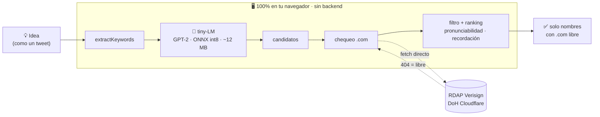
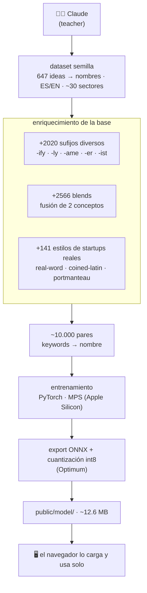

# nominaris

### Un especialista de bolsillo, no un generalista gigante.

Existen modelos de lenguaje que escriben sonetos, debaten a Kant y te explican la mecánica cuántica. Nosotros solo necesitábamos que se le ocurriera **`prestapyme`**. Contratar a un genio de 400 GB para eso parecía… un pelín excesivo.

Así que entrenamos uno **diminuto**, con una sola obsesión en la vida: mirar tu idea y proponer nombres de marca con el **`.com` libre**. Pesa **~12 MB** y vive **entero en tu navegador** — sin backend, sin cuentas, sin descargar medio internet.

`⚡ al instante` · `🔒 sin backend` · `🌐 .com verificado en vivo` · `🧠 IA de ~12 MB`

---

## El truco no es un modelo más grande, es uno más obsesivo

Un modelo gigante es el sabelotodo de la fiesta: fascinante — y también la razón de que pese cientos de GB, queme GPUs y viva detrás de un servidor con nómina propia. Nuestro problema, en cambio, cabe en una sola pregunta: *dada una idea, ¿qué nombre le pongo?* (que además tenga el `.com` libre).

Para eso no queremos un sabelotodo, sino un **obseso**. El tiny-LM no tiene idea de quién ganó la guerra de los treinta años, y le da exactamente igual: toda su (modesta) materia gris se va en inventar `prestapyme`, `amigofutbol` o `cliendato`. Por eso cabe en **~12.6 MB** (int8), se descarga una vez, y corre **donde un modelo grande ni asomaría la cabeza: tu navegador** — con privacidad total, porque tu idea nunca sale de la pestaña.

> **Moraleja:** no necesitas un modelo que lo sepa *todo*; necesitas uno que sepa *lo tuyo*.

---

## Cómo funciona

Todo el pipeline corre en el cliente. Lo único que "sale" son las consultas de dominio a servicios públicos (RDAP/DoH) — nominaris **no tiene backend propio**.



### Las 3 capas

| Capa | Qué hace | Cómo |
|---|---|---|
| **1. Generación** | inventa nombres afines a la idea | tiny-LM GPT-2 (ONNX int8) vía `transformers.js`; prompt `<kw> keywords <gen>` → tokens de nombre |
| **2. Dominio** | filtra a los `.com` libres | **RDAP** de Verisign (404 = libre) + pre-filtro **DoH** de Cloudflare, con `fetch()` directo (CORS abierto) |
| **3. Filtro + ranking** | deja arriba lo memorable | descarta balbuceos/clusters; ordena por brevedad + alternancia consonante-vocal |

> El modelo genera **blends de dos conceptos**, no solo raíz + sufijo:
> `presta` + `pyme` → **prestapyme** · `amigo` + `futbol` → **amigofutbol** · `cliente` + `dato` → **cliendato**

---

## El modelo: entrenado por *teacher-student*

El tiny-LM no sabe nada del mundo; **aprendió a nombrar imitando a un modelo grande** (distillation a nivel de secuencia).



- **Formato:** cada `(keywords → nombre)` es una secuencia `<kw> … <gen> nombre <eos>`, con la pérdida **enmascarada en el prompt** — el modelo solo aprende a *generar* nombres.
- **Por qué enriquecer:** con el dataset crudo el modelo colapsaba a un solo estilo (`-o/-vo`). La augmentación de sufijos, los blends y los estilos de startups reales le dan variedad y capacidad de **combinar conceptos**.
- La semántica (qué nombre pega con qué idea) queda **dentro del modelo**, aprendida de miles de ejemplos — no de reglas escritas a mano.

---

## Entrenar el modelo

En local sobre Apple Silicon (**MPS/Metal**), sin GPU dedicada — o en Colab con un clic:

[](https://colab.research.google.com/github/joelibaceta/nominaris/blob/main/tools/train/notebook.ipynb)

Detalle del pipeline local en [`tools/train/README.md`](tools/train/README.md).

```bash
# 1. (opcional) ampliar el dataset teacher
node tools/augment_suffixes.mjs   # variedad de sufijos
node tools/augment_blends.mjs     # combinaciones de conceptos

# 2. entrenar (Python 3.12)
python -m venv tools/train/.venv && source tools/train/.venv/bin/activate
pip install -r tools/train/requirements.txt
python tools/train/train.py --data data/dataset.jsonl --epochs 40 --n_embd 384 --n_layer 6

# 3. exportar a ONNX int8 -> public/model/
python tools/train/export.py
```

Si no existe `public/model/`, la app cae a un generador algorítmico de respaldo — **nunca se rompe**.

---

## Ejecutar la app

```bash
npm install
npm run dev      # http://localhost:5173
npm run build    # dist/ estático
```

Al ser 100% cliente, se despliega en **GitHub Pages, Vercel, Netlify o cualquier CDN — sin servidor**.

---

## Stack

| Capa | Tecnología |
|---|---|
| Frontend | Vite + TypeScript (vanilla, sin framework) |
| Inferencia | `@huggingface/transformers` (ONNX Runtime Web · WebGPU/WASM) |
| Modelo | GPT-2 ~12M params · BPE 4k · int8 (~12.6 MB) |
| Dominios | RDAP (Verisign) + DNS-over-HTTPS (Cloudflare) |
| Entrenamiento | Python · PyTorch (MPS) · 🤗 Transformers · Optimum |
| Teacher | Claude (generación del dataset) |

**Presupuesto de descarga:** la app en sí es ~5 KB gzip; el **modelo int8 pesa ~12.6 MB** (lo específico de nominaris). El runtime de inferencia (ONNX Runtime Web / WASM) es la pieza más pesada pero es **compartida y cacheable** — se descarga una vez y queda en caché para siempre.

---

## Estructura del repo

```
├─ index.html            landing + composer (estilo tweet)
├─ src/
│  ├─ main.ts            orquestación UI + render en vivo
│  ├─ generate.ts        carga del tiny-LM (transformers.js) + fallback algorítmico
│  ├─ domains.ts         RDAP + DoH, pool de concurrencia
│  └─ rank.ts            filtro de pronunciabilidad + score de recordación
├─ data/dataset.jsonl    dataset teacher (idea → keywords → nombres)
├─ tools/
│  ├─ augment_suffixes.mjs · augment_blends.mjs
│  └─ train/             train.py · export.py · requirements.txt · notebook.ipynb
└─ public/model/         modelo ONNX int8 + tokenizer (generado)
```

---

## Honestidad sobre la calidad

Es un modelo de **12M parámetros y ~12 MB**: hace algo genuinamente difícil (entender una idea y proponer nombres afines, con jerga y combinaciones) en un tamaño minúsculo y sin backend. Pero **no es mágico** — en ideas muy de nicho puede fallar, y algún nombre sale tosco (por eso el filtro y el ranking). El objetivo no es batir a un LLM gigante, sino demostrar **cuánto naming semántico útil cabe en una pestaña del navegador**.

---

<p align="center"><sub>hecho con obsesión · 100% en el cliente</sub></p>
